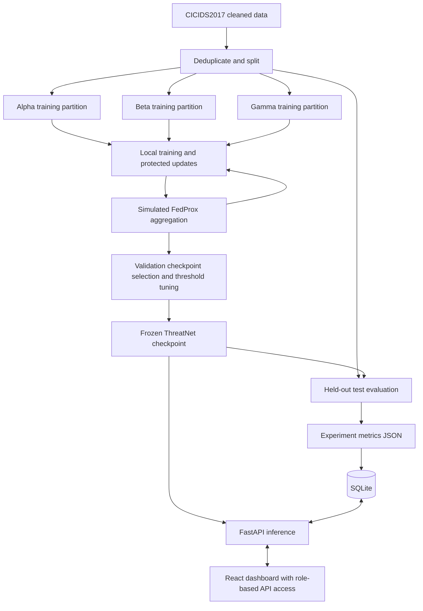

# CYBER-20 — Federated Collaborative Threat Detection

A B.Tech capstone project for KL University (Software Systems Engineering, Cluster A). The goal is to study whether collaboration between organizations improves network threat detection when their training data have different class distributions.

The application combines a React dashboard, a FastAPI backend, a trained PyTorch ThreatNet model and a SQLite database. The verified federated training uses a **single-process simulation** of three organizations. It is not a production distributed intrusion prevention system.

- **Repository:** [Fedrated_Collaborative_System](https://github.com/Yash5429Q/Fedrated_Collaborative_System)
- **Main branch:** `main`
- **Verified local application checkpoint:** `3cf7a46` (before cloud preparation)
- **Cloud demonstration URL:** Pending deployment and online verification.

## Features

- Compare independent local models against a collaborative model on the same held-out test set.
- Simulate IID and Non-IID data partitions using three participating organizations.
- Train with FedAvg or FedProx; select checkpoints using validation macro F1.
- Apply training-only normalization, repair selected corrupt feature values and bound extreme normalized values.
- Use experimental Gaussian noise, update clipping and structural/finite-value update validation.
- Classify 68 raw network flow features into Normal, DoS, Brute Force, Port Scan or Malware.
- Use a validation-selected attack threshold to reduce false alarms.
- Load genuine held-out dataset samples in the prediction screen.
- Optionally save non-Normal predictions as alerts, without storing raw input features. These are predictions, not confirmed incidents.
- Restrict API access with expiring and revocable bearer credentials. Viewer access is read-only; Operator access permits prediction and alert recording.
- Display training history, organization participation, performance, privacy information, testing evidence and prediction alerts.

## Architecture



Training and evaluation take place offline. The web application loads the frozen checkpoint for CPU inference; it does not start a live Flower training server.

## Dataset and experiment

The cleaned CICIDS2017 file contains 42,002 rows and 68 features. After removing duplicate rows, 37,183 records remain. The seed-42 stratified benchmark split is:

| Split | Records |
| --- | ---: |
| Training | 27,892 |
| Validation | 3,716 |
| Test | 5,575 |
| Total | 37,183 |

Training partitions are assigned to Alpha, Beta and Gamma. The registered organization list also contains Delta and Epsilon, which do not participate in this experiment. The validation and test sets are common evaluation sets. Normalization is fitted on the training split only. The reference labels are not passed into the prediction model.

### Frozen deployment candidate

| Setting | Value |
| --- | --- |
| Experiment ID | `exp_20261125_173246_9acfd8aa` |
| Model | ThreatNet |
| Mode | Non-IID (Dirichlet alpha 0.5) |
| Algorithm | FedProx (mu 0.01) |
| Seed | 42 |
| Participants | 3 simulated organizations |
| Rounds completed | 8 |
| Selected checkpoint | Round 6 |
| Local epochs per round | 3 |
| Attack threshold | 0.75, selected on validation data |
| Normalization | `robust_zscore_v1` |
| Update clipping norm | 5 |
| Gaussian noise standard deviation | 0.005 (experimental; no formal DP guarantee) |

The committed checkpoint is stored in `backend/models/latest/`. The experiment evidence is stored in `backend/exp_20261125_173246_9acfd8aa_results.json`.

### Results on the held-out test set

| Metric | Independent local average (Non-IID) | Federated Non-IID |
| --- | ---: | ---: |
| Accuracy | 77.79% | 94.48% |
| Macro precision | 67.61% | 91.53% |
| Macro recall | 82.67% | 95.70% |
| Macro F1 | 72.79% | 93.08% |
| Macro false-positive rate | 5.59% | 1.34% |
| Binary attack detection rate | 96.91% | 99.14% |
| Binary false-positive rate | 68.73% | 17.50% |

The collaborative model improves average local accuracy by 16.69 percentage points. IID federated accuracy is 96.95%, giving Non-IID accuracy retention of 97.45%. Macro FPR averages the one-vs-rest class FPRs; binary FPR measures normal flows incorrectly classified as attacks. They are different measures.

Compared with the corrected 20-round FedAvg baseline without attack-threshold optimization (seed 42), the candidate reduces the modeled client-upload parameter payload by 60% and binary false alarms by 31.22% (378 to 260). The payload estimate is not measured network traffic. Binary attack detection decreases by approximately 0.83 percentage points relative to that baseline. The candidate does not outperform the threshold-optimized 20-round FedAvg baseline on all metrics; no universal superiority or formal KPI pass is claimed.

Confusion matrix (rows = actual classes, columns = predicted classes):

| Actual / Predicted | Normal | DoS | Brute Force | Port Scan | Malware |
| --- | ---: | ---: | ---: | ---: | ---: |
| Normal | 1226 | 79 | 50 | 24 | 107 |
| DoS | 31 | 1262 | 5 | 0 | 0 |
| Brute Force | 3 | 3 | 1074 | 0 | 0 |
| Port Scan | 0 | 0 | 5 | 1408 | 0 |
| Malware | 1 | 0 | 0 | 0 | 297 |

The results describe the frozen benchmark, not accuracy on arbitrary live network traffic.

## Repository layout

```text
backend/
  app/api/v1/            API routes
  app/core/              Configuration and access control
  app/database/          Database initialization and experiment seeding
  app/ml/                Model, data and privacy implementation
  app/models/            Database models
  app/repositories/      Database queries
  app/schemas/           API schemas
  app/services/          Dashboard and experiment metric integration
  models/latest/         Frozen model, normalization and metadata
  tests/                 Automated regression tests
  run_experiment.py      Offline federated simulation
  prepare_deployment.py Read-only local candidate preflight
  activate_deployment.py Controlled local activation
  manage_access.py      Credential issue, list and revoke
  verify_prediction_alerts.py  Live local API verification
  requirements.txt      Local training and testing dependencies
  requirements-deploy.txt  Smaller CPU cloud runtime dependencies
frontend/
  src/                  React dashboard and API client
  package.json          Frontend dependencies and scripts
  vite.config.ts        Local development API proxy
  vercel.json           SPA route rewrites
render.yaml             Render backend configuration
```

## Local setup (Windows CMD)

Use Python 3.12 (the verified environment used 3.12.10) and Node.js 22.12+ within the 22.x series, or Node.js 24.x. Keep the dependency versions used in a successful regression run; do not blindly upgrade them. The local dependency list includes optional Flower and training/test libraries. The separate deployment list intentionally does not include them.

From the project root:

```cmd
cd backend
python -m venv venv
venv\Scripts\activate
python -m pip install --upgrade pip
python -m pip install -r requirements.txt
python -m pip check
```

The default local database is `backend/cyber20.db`. A fresh database is initialized at startup using the experiment matching the committed checkpoint. Existing databases are not overwritten automatically. If the experiment identity does not match an existing local database, use the controlled offline activation workflow or a fresh database after preserving a backup.

Issue a private demo credential (maximum 1440 minutes):

```cmd
python manage_access.py issue operator --minutes 120
python manage_access.py issue viewer --minutes 120
python -m uvicorn app.main:app --host 127.0.0.1 --port 8000
```

In another terminal, from the project root:

```cmd
cd frontend
npm ci
npm run dev
```

If a lockfile is missing, generate and commit the lockfile using `npm install` and verify the build before deploying. Open `http://localhost:5173` and sign in with the bearer token, not its credential ID. The token is held in browser memory; a full reload may require signing in again.

### API and credentials

- `GET /health`: public liveness check.
- `GET /api/access/session`: authenticated role check.
- `GET /api/predict/health`: checkpoint readiness.
- `GET /api/predict/samples`: Operator-only benchmark samples.
- `POST /api/predict`: Operator-only prediction, with optional `record_alert`.
- `GET /api/dashboard`, `/api/organizations`, `/api/training`, `/api/threats`, `/api/performance`, `/api/privacy`: authenticated application data.

`python manage_access.py list` reports credential status. `python manage_access.py revoke CREDENTIAL_ID` revokes a credential. The registry defaults to `~/.cyber20/access.json` and contains token hashes, roles, expiry times and revocation flags. Keep both the registry and raw tokens private. Never commit them or put them in `VITE_*` environment variables.

## Testing and reproducibility

From `backend/` with the virtual environment activated:

```cmd
python -m pytest tests/ -q --tb=short
```

Verified local evidence before cloud preparation: **250 passed, 2 warnings, 33.64 seconds**. The deployment seeding update adds five tests; rerun the complete suite to establish the updated count. The frontend production build also passed before cloud preparation. Automated regression testing is separate from university acceptance testing.

Run `python verify_prediction_alerts.py` while the local backend is running; enter a private Operator token when prompted. `--record-one` intentionally adds one new dataset-based prediction alert. Use this option only when a new alert is wanted.

Optional offline reproduction (not needed for web deployment):

```cmd
python run_experiment.py --rounds 8 --epochs 3 --alpha 0.5 --noise-multiplier 0.001 --proximal-mu 0.01 --tune-attack-threshold --seed 42 --no-publish --export-checkpoint non_iid
```

This creates a new experiment candidate, not an automatic replacement for the frozen deployment. Exact numerical reproduction depends on the software/hardware environment. Preserve the committed checkpoint and evidence. Historical experiment directories are ignored by Git; local `prepare_deployment.py` uses the original exported directory, which may not be present in a clean clone.

## Cloud deployment (planned, not yet verified)

Proposed academic demo: Render FastAPI backend and Vercel React frontend, both from `main`. The database is SQLite on the free Render filesystem. Recorded alerts may reset after restart, sleep or redeployment; the experiment metrics can be reseeded from committed evidence. Persistent storage and production hardening are separate tasks.

### Render backend

- Root directory: `backend`
- Python version: `3.12.10`
- Build/start commands: see `render.yaml`.
- Health check: `/health` (liveness only; verify model readiness separately).
- `ENVIRONMENT=production`, `DEBUG=false`
- `DATABASE_URL=sqlite+aiosqlite:///./cyber20.db`
- `CORS_ORIGINS`: exact deployed Vercel HTTPS origin (no trailing slash).
- `ACCESS_REGISTRY_PATH=/etc/secrets/access.json`

Create a separate cloud credential registry locally with `manage_access.py` and upload its JSON contents via Render Secret Files under the name `access.json`. Do not publish the file or the bearer tokens. The service rejects missing/invalid/expired/revoked credentials. Regenerate short-lived evaluator credentials as needed; uploading a changed secret file requires applying the updated service configuration.

The initial plan uses a single CPU worker and installs the CPU PyTorch wheel rather than the CUDA build. Free hosting has memory and cold-start constraints; successful startup and actual inference must be tested before declaring deployment complete. Dependency versions for Linux still need verification against the working local environment.

### Vercel frontend

- Framework: Vite; root directory: `frontend`
- Node.js: 22.x (at least 22.12) or 24.x
- Install: `npm ci`; build: `npm run build`; output: `dist`
- Set `VITE_API_BASE_URL` to the actual Render HTTPS backend origin followed by `/api`.
- `vercel.json` supports refreshing and opening nested dashboard routes directly.

Configure the backend CORS origin after the frontend URL is known and redeploy as necessary. Test anonymous 401, Viewer read access, Viewer prediction rejection, Operator inference, and a recorded sample alert. Verify experiment ID, 94.48% displayed accuracy, and threshold 0.75. The public URL will be added here after these checks pass. Evaluator credentials are supplied privately, never in the report or README.

Official guides: [Render Web Services](https://render.com/docs/web-services), [Render free hosting](https://render.com/docs/free), [Render secrets](https://render.com/docs/configure-environment-variables), [Vercel Vite deployment](https://vercel.com/docs/frameworks/frontend/vite), [PyTorch CPU installation](https://pytorch.org/get-started/locally/).

## Limitations

- Federated organizations are simulated within one process; no live distributed Flower server or client identity verification is established by the reported experiment.
- Raw training partitions are separate in the simulation, but shared preprocessing statistics and model updates can reveal information. Seeded noise, released buffers and logs, privacy accounting and composition do not establish formal differential privacy. Secure aggregation is not implemented.
- API bearer-token access is a demonstration mechanism, not enterprise identity management. No guarantee of production security or independent penetration testing is claimed.
- Prediction alerts are not confirmed attacks. The application does not capture live packets or block network traffic.
- Independent external validation, full university acceptance and generalization to external datasets remain pending.
- Free cloud storage is not persistent; the hosted application is intended for controlled academic demonstration, not sensitive or mission-critical workloads.
